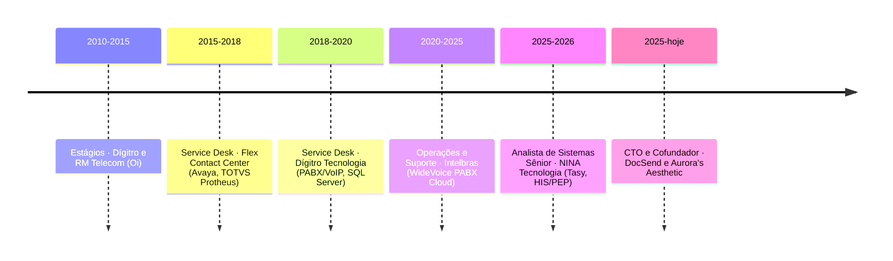

<div align="center">


<a href="https://github.com/caarlosandree">
  
</a>

<br/><br/>

<a href="https://www.linkedin.com/in/caarlosandree/"></a>
<a href="mailto:caarlosandree@gmail.com"></a>
<a href="https://caarlosandree.github.io/portfolio/"></a>


</div>

<br/>

## 👨‍💻 Sobre mim

```java
public record CarlosSabino(
    String cargo      = "CTO & Cofundador · Analista de Sistemas Sênior",
    String local      = "São José/SC 🇧🇷",
    int    anosDeTI   = 16,
    List<String> foco = List.of("SaaS ponta a ponta", "Integrações em saúde", "IA generativa aplicada"),
    String estudando  = "Ciência da Computação @ Estácio"
) {}
```

- 🚀 **CTO e cofundador de dois produtos SaaS em produção**: [DocSend](https://docsend.com.br/) (ERP contábil) e [Aurora's Aesthetic](https://www.aurora-aesthetic.com.br/) (gestão de clínicas de estética). Sou o único desenvolvedor e líder técnico, dos requisitos ao deploy.
- 🏥 **Saúde digital**: integração e sustentação do **Tasy** (views, functions e procedures em Oracle PL/SQL), além de integrações REST/Webhooks com Feegow, RealClinic, Clínica nas Nuvens e outros HIS/PEP, tudo dentro da **LGPD**.
- 📞 **Telecom de raiz**: VoIP, PABX IP e Cloud (WideVoice/Intelbras), Avaya e WhatsApp Business API. Foram anos como suporte N3 em sistemas de missão crítica.
- 🤖 **IA no dia a dia**: LLMs, agentes, RAG e MCP nos produtos e no próprio fluxo de engenharia (code review, testes e documentação com agentes).

<br/>

## 🏆 Destaques

<table>
  <tr>
    <td align="center" width="25%"><h3>16+</h3>anos em TI</td>
    <td align="center" width="25%"><h3>2</h3>SaaS em produção como CTO</td>
    <td align="center" width="25%"><h3>60+</h3>repositórios</td>
    <td align="center" width="25%"><h3>6</h3>linguagens em produção</td>
  </tr>
</table>

- 🧱 Produtos construídos do zero com **Java 25 + Spring Boot**, **Next.js 16 + React 19**, apps **Flutter** e microsserviços em **Go**, com Testcontainers e OpenTelemetry.
- 🔗 Integração de plataforma multicanal de confirmação de consultas (WhatsApp, SMS e voz) com os principais sistemas de gestão hospitalar do país.
- ⚡ Uso de IA generativa na triagem de chamados e na análise de logs para **reduzir o TTR** de incidentes críticos.
- 🎓 Formações Alura: **Engenharia de Agentes de IA**, **Java e Spring Boot**, **Flutter** e **Banco de Dados**. Cloud: GCP, Azure e AWS (Bedrock).

<br/>

## 💼 Produtos que eu construo

<table>
  <tr>
    <td width="50%" valign="top">
      <h3>📄 <a href="https://docsend.com.br/">DocSend</a></h3>
      <p>ERP contábil SaaS: gestão de documentos, clientes e rotinas de escritórios de contabilidade. Web + app mobile.</p>
      
      
      
      
      
    </td>
    <td width="50%" valign="top">
      <h3>💆 <a href="https://www.aurora-aesthetic.com.br/">Aurora's Aesthetic</a></h3>
      <p>SaaS para clínicas de estética: agenda, pacientes e confirmações automáticas via WhatsApp (serviço Go com RabbitMQ e Redis).</p>
      
      
      
      
      
    </td>
  </tr>
</table>

<br/>

## 📌 Projetos em destaque

<div align="center">
  <a href="https://github.com/caarlosandree/walletflow"></a>
  <a href="https://github.com/caarlosandree/truco-multiplayer"></a>
  <a href="https://github.com/caarlosandree/desafio-tecnico-viacep"></a>
  <a href="https://github.com/caarlosandree/rules-examples"></a>
  <a href="https://github.com/caarlosandree/desafio-impact-hub"></a>
  <a href="https://github.com/caarlosandree/grounded-trainer"></a>
</div>

| Projeto | O que é | Stack |
|---|---|---|
| [**walletflow**](https://github.com/caarlosandree/walletflow) | Carteira digital em monólito modular, orientada a eventos, com outbox transacional | Java 25 (Virtual Threads), Spring Modulith |
| [**truco-multiplayer**](https://github.com/caarlosandree/truco-multiplayer) | Truco paulista em tempo real com servidor autoritativo e anti-cheat | Go, WebSocket, Vue 3 |
| [**desafio-tecnico-viacep**](https://github.com/caarlosandree/desafio-tecnico-viacep) | API que extrai e expõe endereços do ViaCEP, com autenticação por chave | FastAPI, PostgreSQL, Alembic, Docker, CI |
| [**rules-examples**](https://github.com/caarlosandree/rules-examples) | Catálogo de regras para agentes de IA (Claude Code, Cursor, Windsurf, Copilot) em 11 stacks | IA / DX |
| [**desafio-impact-hub**](https://github.com/caarlosandree/desafio-impact-hub) | Recepção e registro automático de notas fiscais de fornecedores | n8n, Google Workspace, Gemini |
| [**grounded-trainer**](https://github.com/caarlosandree/grounded-trainer) | Trainer nativo para Linux (Proton), estudo de engenharia reversa | Rust |
| [**bolaoCopa**](https://github.com/caarlosandree/bolaoCopaFrontend) · [demo](https://bolao-copa-frontend.vercel.app) | Bolão corporativo da Copa do Mundo | Go + Next.js |
| [**widevoice_grav_download**](https://github.com/caarlosandree/widevoice_grav_download) | Download em massa de gravações do PABX Cloud WideVoice | Python |

<br/>

## 🛠️ Stack

#### 💻 Linguagens
<p>
  
  
  
  
  
  
  
</p>

#### ⚙️ Frameworks
<p>
  
  
  
  
  
  
  
</p>

#### 🗄️ Dados e mensageria
<p>
  
  
  
  
  
  
  
  
</p>

#### ☁️ Cloud e DevOps
<p>
  
  
  
  
  
  
  
  
</p>

#### 🤖 IA generativa
<p>
  
  
  
  
  
  
  
</p>

#### 🏥 Saúde e 📞 Telecom
<p>
  
  
  
  
  
  
</p>

<br/>

## 🧭 Trajetória



<br/>

## 📊 GitHub em números

<div align="center">
  
  
  <br/>
  
</div>

<br/>

## 🐍 Contribuições

<div align="center">
  <picture>
    <source media="(prefers-color-scheme: dark)" srcset="https://raw.githubusercontent.com/caarlosandree/caarlosandree/output/github-snake-dark.svg" />
    <source media="(prefers-color-scheme: light)" srcset="https://raw.githubusercontent.com/caarlosandree/caarlosandree/output/github-snake.svg" />
    
  </picture>
</div>

<br/>

<div align="center">
  <i>"Sistemas de missão crítica não perdoam improviso: arquitetura, observabilidade e um bom playbook."</i>
  <br/><br/>
  
</div>
